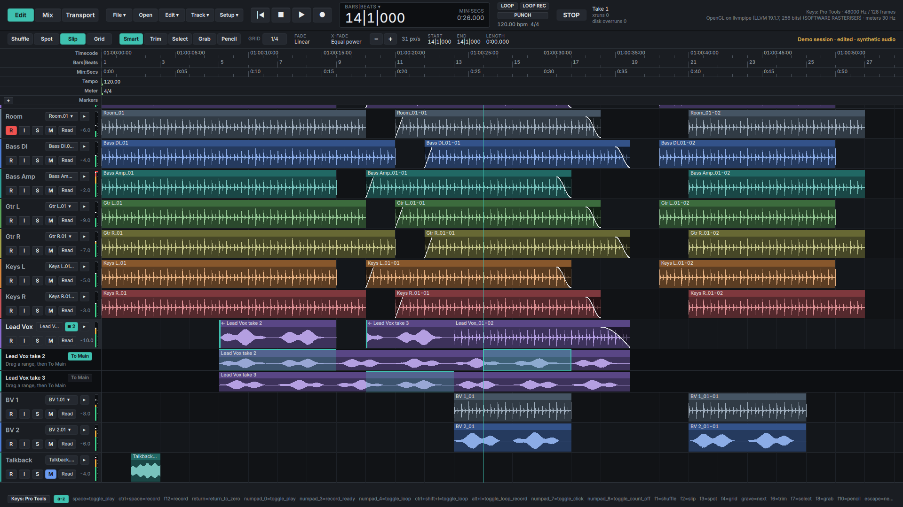
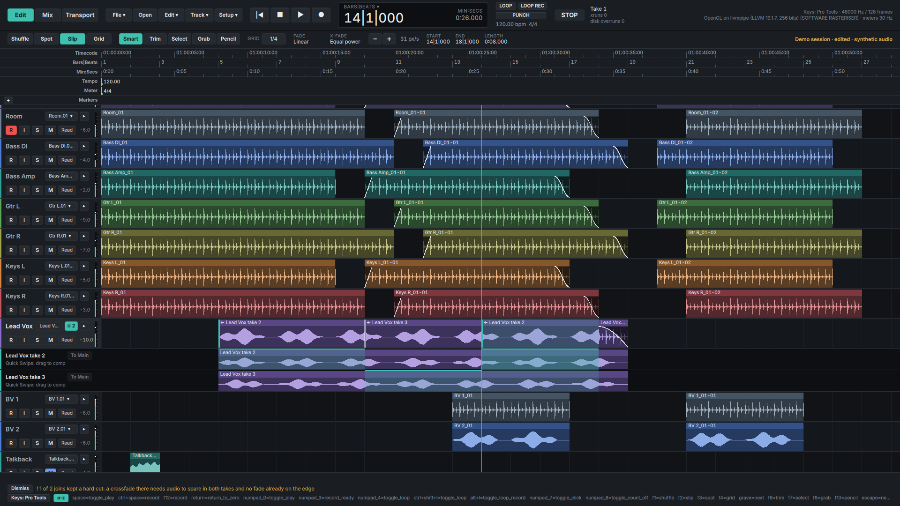
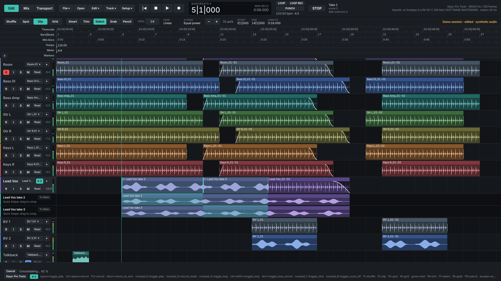

# Comping a vocal

A walkthrough for an engineer who has comped in Pro Tools or Logic. Nothing
here is new to you except where the buttons are. The same path is the
scripted test `ui/qt/tests/test_comping.cpp` (`test_exit`), which runs it in
the real window with the Pro Tools key map.

## 1. Get the takes under the track

Loop-record the phrase (Record with loop on): each pass is a playlist of the
track. Or record a take, make a **New Playlist** from the playlist selector on
the track header, and record the next onto it.

A track with other playlists shows a **`≡ 2`** button on its header, the
number of takes it holds. Click it (or `ctrl+alt+l`): the takes appear as
lanes under the track, one row each, named by their playlist. Click again to
put them away. A track with a single playlist has no button; asking for the
lanes by key says what makes some.

## 2. Make the comp

Press **New comp** (`ctrl+alt+n`) if the track's playlist is one of the takes
you want to keep as it is: it adds an empty playlist, "Vox.01 comp", makes it
the one that plays, and the earlier one becomes a lane. Skip this to comp
straight onto the playlist that plays now, as Pro Tools does.

## 3. Pick the good parts

Drag across a lane over the part you want. Nothing is copied yet: the range is
outlined on the lane and the **To Main** button on that lane lights. A click
on a region of the lane picks that whole region.

Press **To Main** (or `ctrl+alt+c`). The range is copied to the playlist that
plays, as one step: it replaces what was there, silence included. The comp
names the take each piece came from (`← Vox take 2`), and the lane tints the
parts the comp keeps. The swiped range is selected, so Loop Playback auditions
it.

Wrong? **Undo** (`ctrl+z`) takes away that one copy.

If you press To Main with nothing selected on a lane, the window says so under
the track and keeps saying it until you dismiss it.

## Quick Swipe (Logic)

`ctrl+alt+q` turns Quick Swipe on (it is on under the Logic key map). A drag
on a lane then copies as you let go, and each join gets a 10 ms crossfade. If
a join has no audio to spare beyond the swipe it stays a cut, and the window
tells you how many.

## 4. Make it one clip

Select the range or the region of the comp and press **Consolidate**
(`alt+shift+3` in the Pro Tools map, `ctrl+b` in Logic's). The engine renders
the comp to a new file and replaces the range with it, as one undo step
(Undo brings the pieces back; the file stays in the session's Audio Files).
While it renders, the window shows the progress with a **Cancel**; if it
cannot (a take is recording, the disk is full) the reason is held under the
window until you **Dismiss** it.

## What is not here yet

MIDI comping, a collapsed take folder (one row for all the takes), and a
swipe across several tracks.
